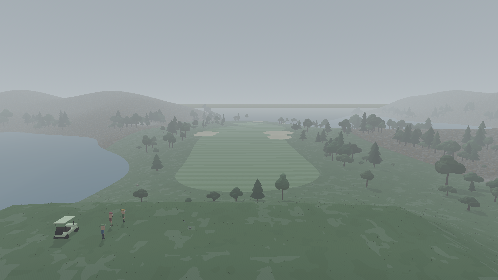
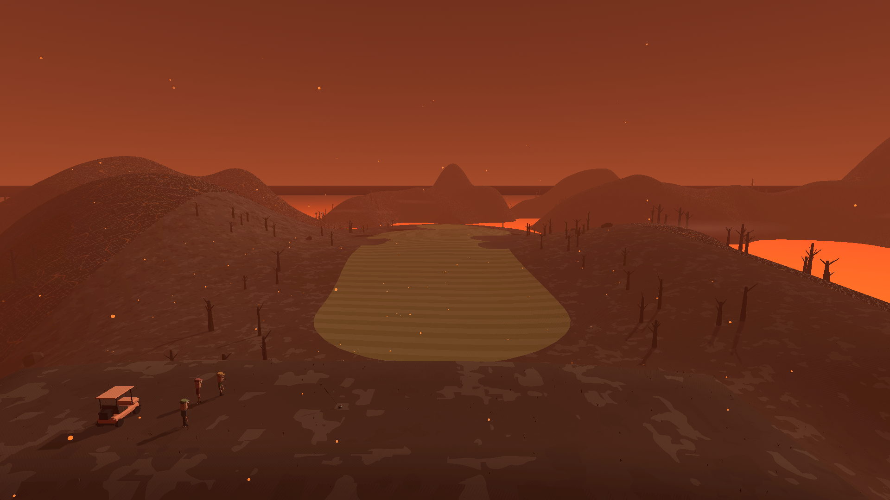
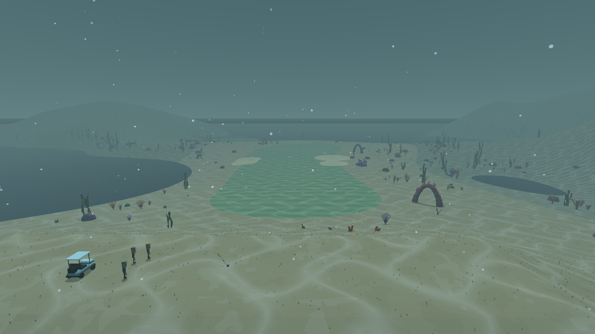
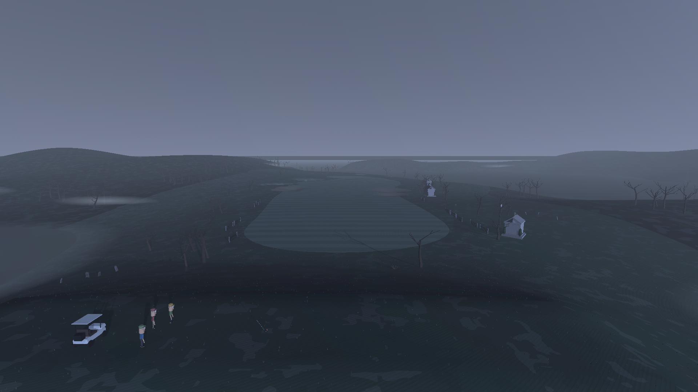
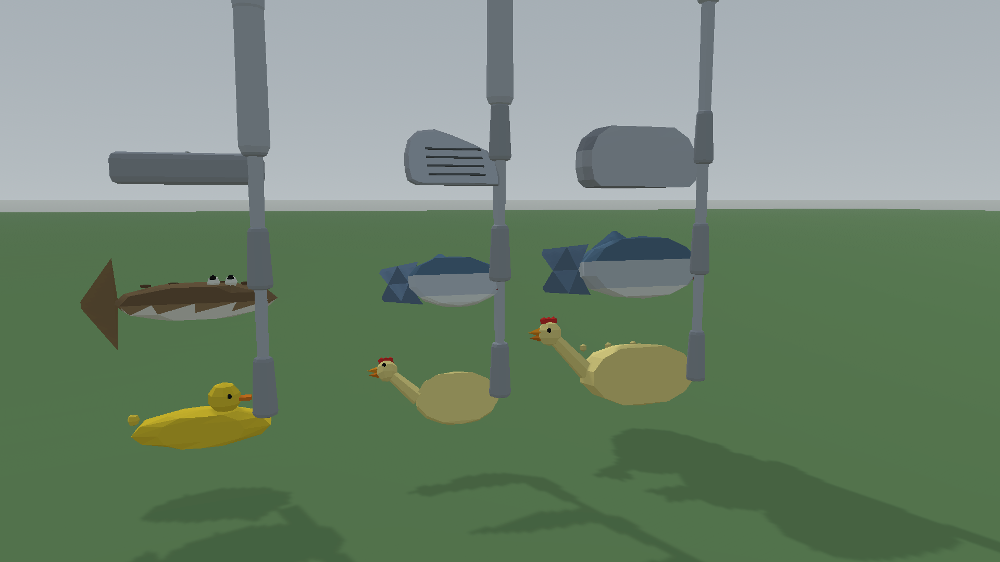

# In The Rough

A first-person golf game where you swing the club with your mouse. Pull back for the backswing,
push through for the hit, and the speed and path of your hand decide the shot: power, draw, fade,
a duffed chip or a towering drive. Play with friends on a dedicated server, across procedurally
generated courses in seven biomes, from a misty parkland to a lava field and the sea floor. Every
hole you finish earns coins to spend in the golf shop on hats, shoes, ball skins, trails and
ridiculous novelty club heads.

Built with Godot 4.7.



| | |
|---|---|
|  |  |
|  |  |
|  | |

<!-- TODO: swing GIF -->
*Swing GIF coming soon.*

## Features

- **Mouse swing.** The club follows your hand on a physical swing arc; tempo and path, not a
  timing bar, decide power and curve. 11 clubs from driver to putter, each with its own feel.
- **Multiplayer with a dedicated server.** Server-authoritative physics, rooms of up to 8 with a
  6-character join code (or a Steam invite), spectating, chat, scorecards and mulligans. Run your
  own server: see [docs/hosting.md](docs/hosting.md).
- **7 biomes.** Parkland, Oasis, Underwater, Magma, Mystic Forest, Deep Forest and Cemetery, each
  with its own terrain, hazards, props, weather particles and ambient soundscape. Courses are
  generated from a seed, so the same seed gives everyone the same holes.
- **Shop and cosmetics.** Earn coins per hole and spend them on hats, shoes, ball skins, ball
  trails and novelty club heads. Coins belong to your computer, so you can rename freely.
- **Practice range.** A driving range with distance boards and unlimited balls, plus a sloping
  putting green with nine cups.
- **Single player.** Play a full round offline, no server needed.

## Controls

| Action | Input |
|---|---|
| Swing | Move the mouse back (backswing), then forward through the ball |
| Aim | Hold right mouse button and move the mouse |
| Turn at address | A / D |
| Walk | F to switch between walking and the shot, then W A S D and the mouse |
| Clubs | Q (hold) for the club wheel, `[` / `]` to step, 1–0 to pick, P for the putter |
| Re-address | R |
| Mulligan (online) | M |
| Next hole (offline) | N |
| Scorecard | Hold Tab (tap to switch player while spectating) |
| Chat | Enter |
| Menu and settings | Esc |
| Practice range | R re-tee, G switch range / green, C next cup, Esc back to the menu |
| Debug overlay | F3 (H shows the hitbox) |

## Building

You need [Godot 4.7.2](https://godotengine.org/download) and its export templates
(Editor → Manage Export Templates → Download). The project is in `game/`.

**Run from the editor:** open `game/project.godot` in Godot and press F5.

**Windows:**

```sh
cd game
godot --headless --export-release "Windows Desktop" build/InTheRough.exe
```

**macOS** (can be exported from any OS; the app is unsigned, so on first launch right-click →
Open):

```sh
cd game
godot --headless --export-release "macOS" build/mac/InTheRough.zip
```

**Tests** are headless Godot scripts in `game/tests/`, e.g.
`godot --headless --fixed-fps 120 --path game -s res://tests/feel_regression_test.gd`.

## Multiplayer server

Online play needs a dedicated server. Out of the box the client connects to `127.0.0.1`. To
host one (a Linux build, a systemd unit, UDP 7777, with Tailscale sharing or port forwarding),
see **[docs/hosting.md](docs/hosting.md)**.

## Licence

Code and original assets: [MIT](LICENSE). Third-party libraries and sounds are listed in
[THIRD_PARTY.md](THIRD_PARTY.md).

Inspired by This Is Golf.
