<p align="center">
  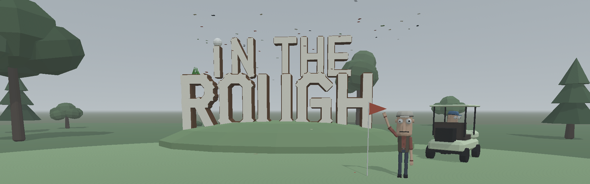
</p>

<p align="center"><b>First-person golf where you swing the club with your mouse.</b><br>
Procedural courses in seven biomes, friends on your own server, and a shop full of terrible hats.</p>

<p align="center">
  <a href="LICENSE"></a>
  <a href="https://godotengine.org"></a>
  
</p>

<p align="center">
  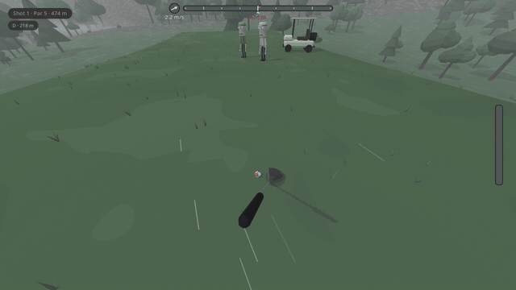
</p>

## Features

<table>
  <tr>
    <td width="50%"><br><b>Mouse swing.</b> Pull back, push through: the speed and path of your hand set power, draw and fade. No timing bar.</td>
    <td width="50%">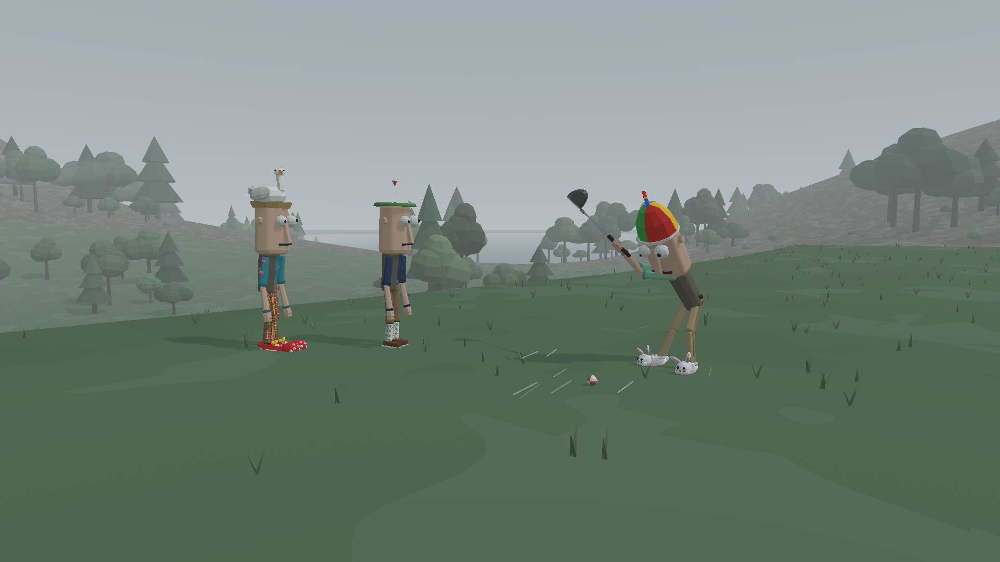<br><b>Multiplayer.</b> Rooms of up to 8 with a 6-character code or a Steam invite, on a server-authoritative dedicated server.</td>
  </tr>
  <tr>
    <td>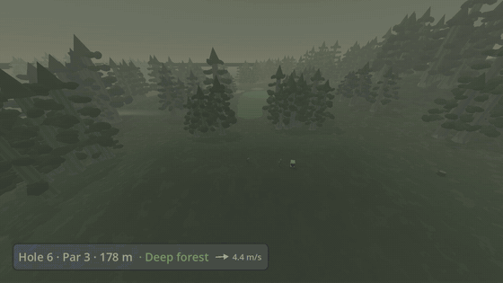<br><b>Procedural courses.</b> Every hole is generated from a seed, the same for everyone in the room, and introduced by a flyover.</td>
    <td>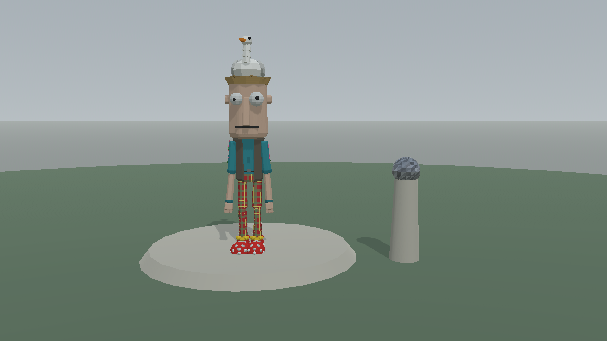<br><b>Shop and cosmetics.</b> Earn coins every hole; spend them on hats, shoes, ball skins, trails and novelty club heads.</td>
  </tr>
  <tr>
    <td>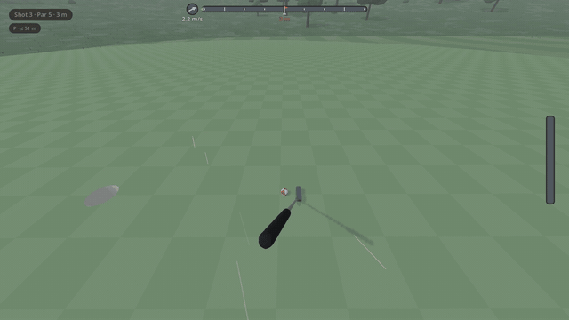<br><b>Every putt counts.</b> The cup is real physics: lip-outs, rim rides and a crowd that cheers your birdies.</td>
    <td>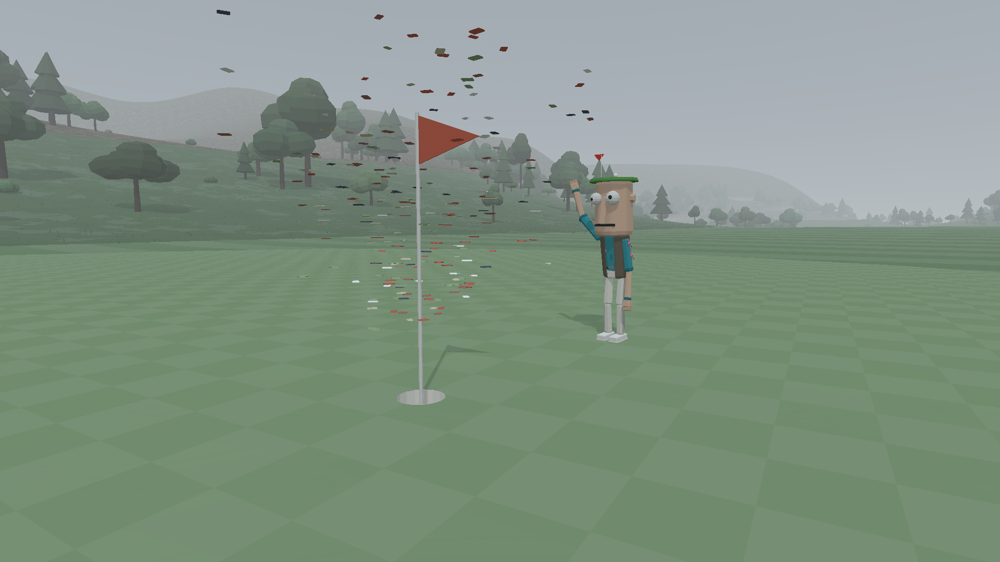<br><b>Practice range and single player.</b> A driving range with distance boards and a sloping putting green, plus full rounds offline.</td>
  </tr>
</table>

## Biomes

<table>
  <tr>
    <td align="center">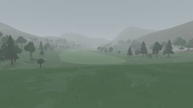<br>Parkland</td>
    <td align="center">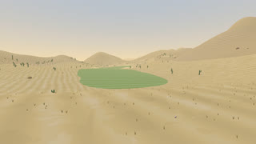<br>Oasis</td>
    <td align="center">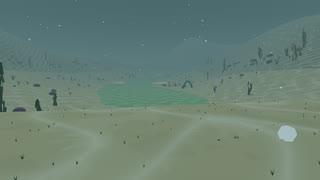<br>Underwater</td>
    <td align="center">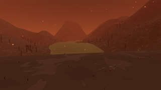<br>Magma</td>
  </tr>
  <tr>
    <td align="center">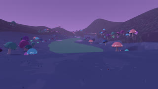<br>Mystic forest</td>
    <td align="center">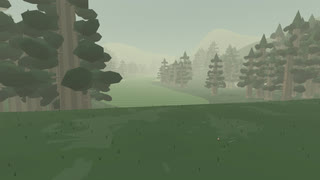<br>Deep forest</td>
    <td align="center">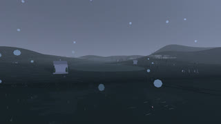<br>Cemetery</td>
    <td></td>
  </tr>
</table>

Each has its own terrain, hazards, props, weather and ambient soundscape. Full-size shots are in [docs/media](docs/media).

## Controls

| | |
|---|---|
| **Swing** | mouse back, then forward through the ball |
| **Aim** | hold right mouse + move |
| **Turn at address** | A / D |
| **Clubs** | hold Q for the wheel · `[` `]` step · 1–0 pick · P putter |
| **Walk** | F, then W A S D |
| **Re-address · Mulligan · Next hole** | R · M (online) · N (offline) |
| **Scorecard · Chat · Menu** | hold Tab · Enter · Esc |
| **Practice range** | R re-tee · G range / green · C next cup |

## Download

Windows and macOS builds are on the [Releases](../../releases) page. Unzip and run. The macOS
app is unsigned: right-click → Open the first time.

The release builds connect to `127.0.0.1` for online play, so single player and the practice range
work anywhere, and multiplayer needs a server (below).

## Build

You need [Godot 4.7.2](https://godotengine.org/download) with its export templates. The project
is in `game/`; open `game/project.godot` and press F5 to play.

```sh
cd game
godot --headless --export-release "Windows Desktop" build/InTheRough.exe
godot --headless --export-release "macOS" build/mac/InTheRough.zip
```

Tests are headless Godot scripts in `game/tests/`, e.g.
`godot --headless --fixed-fps 120 --path game -s res://tests/feel_regression_test.gd`.
The media in `docs/media` is rendered by `game/art/media_capture.gd` and `tools/make_media.sh`.

## Host your own server

The dedicated server is the same project exported for Linux: a systemd unit, UDP 7777, and
Tailscale sharing or port forwarding. Step by step: **[docs/hosting.md](docs/hosting.md)**.

## Credits

- Sound effects: [Kenney](https://kenney.nl) (CC0). Ambience and comedy sounds are generated by
  the project.
- Steam integration: [GodotSteam](https://godotsteam.com) (MIT).
- Built with the [Godot Engine](https://godotengine.org).
- Full list with licences: [THIRD_PARTY.md](THIRD_PARTY.md).

Code and original assets are [MIT](LICENSE).

Inspired by This Is Golf.
