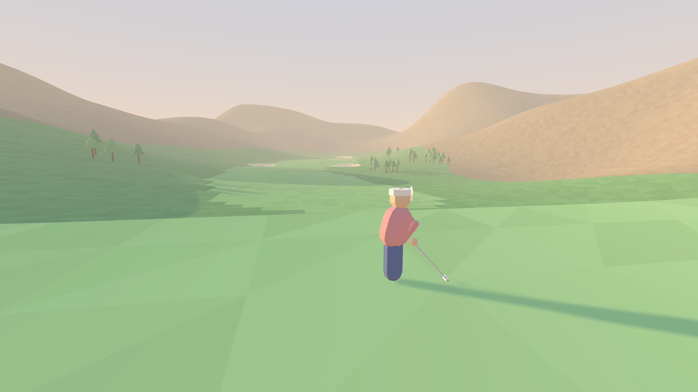
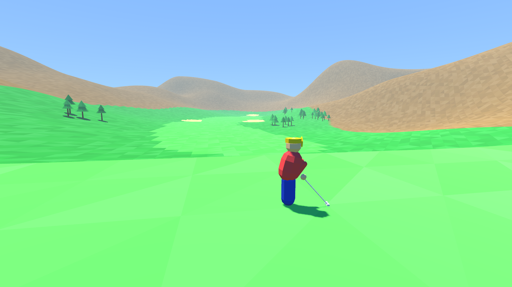
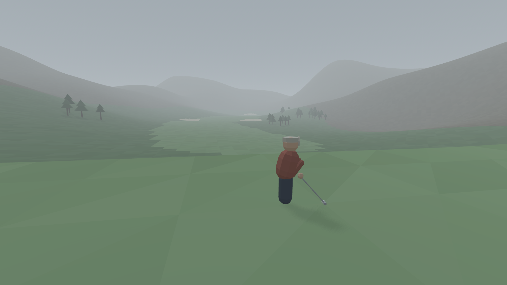
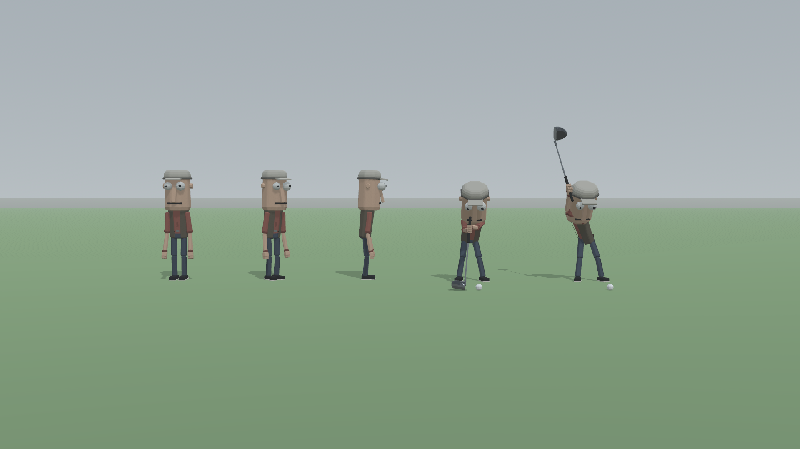

# Art direction: step 3.0 mocks

> **Decision (2026-10-19): preset C, muted overcast, is the chosen look.** Its palette below is the
> project palette, and `game/art/presets/overcast.tscn` is the game's default environment (sky,
> ambient, fog, sun), instanced by `game/main.tscn`. Presets A and B stay as files for reference
> and are unused.

Three candidate looks for the same shot: course seed `0x1`, hole 1 (par 5, hole seed
`0xa6163c0bff483873`), from behind the golfer on the tee. Nothing in gameplay, physics, procgen or
netcode changed, and the game still uses its placeholder look: these are presets for choosing a
direction, not yet wired into `main.tscn`.

| (a) Warm pastel morning | (b) Saturated cartoon midday | (c) Muted overcast |
|---|---|---|
|  |  |  |

## Shared rules (all three)

- **Flat-shaded low-poly, vertex colors only, no textures.** Terrain is re-meshed from the hole's
  own quantised data: every 4 m cell is two flat triangles with one palette color each, plus a
  small deterministic per-face brightness jitter (`face_jitter`) so facets read.
- **Chunky props:** six-sided trunks under two stacked seven-sided cones (sized from each tree's
  existing collider); a capsule golfer (legs, torso, head, cap and visor, arms, club) at address;
  a pole, triangular flag and cup; an eight-sided ball.
- **One directional sun with soft shadows, a sky-gradient ambient (procedural sky), light distance
  fog.** Linear tonemap so the hex palette lands on screen as written (vertex colors are sRGB).
- The dresser swaps meshes only: colliders, hole data and procgen output are untouched.

## (a) Warm pastel morning: `game/art/presets/morning.tscn`

Low warm sun from the side for long soft shadows; peach horizon, milky fog.

| Role | Hex | | Role | Hex |
|---|---|---|---|---|
| Fairway | `#9CCB86` | | Trunk | `#8A6A55` |
| Rough | `#7DAE72` | | Canopy / alt | `#6FA06A` / `#86B37A` |
| Green | `#B5DE97` | | Shirt | `#E8A0A0` |
| Sand | `#F2DFB4` | | Pants | `#6E7FA8` |
| Water | `#8CC3D9` (alpha 0.85) | | Skin | `#F1C9A5` |
| Out of bounds / hills | `#A99A7E` | | Cap | `#F4F0E6` |
| Tee pad | `#A8D392` | | Club | `#CFCFCF` |
| Flag / pole / cup | `#F28B6E` / `#F5F2EA` / `#3B3B3B` | | Ball | `#FFFFFF` |

- Sky: top `#A9C6E8`, horizon `#F7D9B9`, ground `#C9B79C` → `#EBCFB2`.
- Sun: `#FFD9A8`, energy 1.6, 14° above the horizon, yaw 55°; shadow opacity 0.8, blur 3, angular size 2°.
- Ambient: from sky, energy 0.6. Fog: `#F3DCC4`, density 0.0012. Face jitter ±4%.

## (b) Saturated cartoon midday: `game/art/presets/cartoon.tscn`

High sun, short crisp shadows, strong blue sky, bright greens; low ambient for contrast.

| Role | Hex | | Role | Hex |
|---|---|---|---|---|
| Fairway | `#4CC94A` | | Trunk | `#7A4A22` |
| Rough | `#2E9E3A` | | Canopy / alt | `#1E8F3A` / `#34B24A` |
| Green | `#7CF06A` | | Shirt | `#FF4B4B` |
| Sand | `#FFE07A` | | Pants | `#2546C9` |
| Water | `#1FA7FF` (alpha 0.9) | | Skin | `#FFC896` |
| Out of bounds / hills | `#8A6E3E` | | Cap | `#FFD21F` |
| Tee pad | `#5ADB55` | | Club | `#E0E0E0` |
| Flag / pole / cup | `#FF2E2E` / `#FFFFFF` / `#1A1A1A` | | Ball | `#FFFFFF` |

- Sky: top `#2E8BFF`, horizon `#9FD8FF`, ground `#6E9B4A` → `#A7D97E`.
- Sun: `#FFF6E0`, energy 2.2, 65° up, yaw 35°; full-opacity shadows, blur 1, angular size 0.5°.
- Ambient: from sky, energy 0.35. Fog: `#BFE6FF`, density 0.0006. Face jitter ±6%.

## (c) Muted overcast: `game/art/presets/overcast.tscn` (CHOSEN: project palette)

Weak diffuse sun, faint shadows, grey-green desaturated palette, heavier fog; flat even light.

| Role | Hex | | Role | Hex |
|---|---|---|---|---|
| Fairway | `#7F9A72` | | Trunk | `#5E5249` |
| Rough | `#67805F` | | Canopy / alt | `#50684D` / `#5E7759` |
| Green | `#93AE84` | | Shirt | `#A56A5F` |
| Sand | `#CDC4AA` | | Pants | `#4D5765` |
| Water | `#7F96A0` (alpha 0.8) | | Skin | `#D8B79E` |
| Out of bounds / hills | `#7A7466` | | Cap | `#C9C5BA` |
| Tee pad | `#88A27B` | | Club | `#A9ACAE` |
| Flag / pole / cup | `#C2614E` / `#E2E2DE` / `#2E2E2E` | | Ball | `#F0F0F0` |

- Sky: top `#8E99A3`, horizon `#B9C0C4`, ground `#6F746C` → `#9DA39C`.
- Sun: `#E6E9EC`, energy 0.45, 50° up, yaw 20°; shadow opacity 0.35, blur 4, angular size 3°.
- Ambient: from sky, energy 1.0. Fog: `#B4BCC0`, density 0.0022. Face jitter ±3%.

## Notes for choosing

- **Readability:** (b) separates fairway, rough, sand and hills most clearly at distance; (a) is
  the warmest and most "cosy" but the pastel greens of fairway and rough sit close together;
  (c) is moody but hazards nearly disappear past ~200 m.
- **Visible issue in all three:** fairway and green edges show the 4 m map grid as stair-steps,
  because each cell takes one lie. Fixing it is a terrain-mesh job (split cells along the mask
  boundary or blend colors at edges), not a palette one. *Fixed 2026-10-20:* the terrain shader
  decides the lie per fragment from the masks (same sample and thresholds as the ball), so edges are
  crisp lines; the masks are data textures, colors are still flat palette tones plus flat patterns.
- **The flag is built but out of frame:** this par 5's cup is ~450 m from the tee. A green-side
  shot is the next useful mock.
- The golfer in these mocks is placeholder geometry; the real character is below (step 3.1).

## Re-rendering

```sh
cd game
godot --path . --resolution 480x270 -s res://art/capture.gd
```

Godot's `--headless` mode has no renderer, so this opens a small window for a few seconds; each
shot is rendered offscreen at 1920×1080 and written to `docs/art/mock-{a,b,c}.png`. Edit a
preset's colors in its `.tscn` (root node exports, sky material, sun, environment) and re-run.

## Project palette (from preset C)

The canonical colors for everything we build from here on. Source of truth in the engine:
`game/art/presets/overcast.tscn` (root node exports, sky material, sun, environment).

| Group | Role | Hex |
|---|---|---|
| Ground | Fairway | `#7F9A72` |
| | Rough | `#67805F` |
| | Green | `#93AE84` |
| | Tee pad | `#88A27B` |
| | Sand | `#CDC4AA` |
| | Water | `#7F96A0` (alpha 0.8) |
| | Out of bounds / hills | `#7A7466` |
| Trees | Trunk | `#5E5249` |
| | Canopy / alt | `#50684D` / `#5E7759` |
| Golfer | Shirt / pants / skin / cap / club | `#A56A5F` / `#4D5765` / `#D8B79E` / `#C9C5BA` / `#A9ACAE` |
| Pin | Flag / pole / cup | `#C2614E` / `#E2E2DE` / `#2E2E2E` |
| Ball | Ball | `#F0F0F0` |
| Sky | Top / horizon | `#8E99A3` / `#B9C0C4` |
| | Ground bottom / horizon | `#6F746C` / `#9DA39C` |
| Light | Sun | `#E6E9EC`, energy 0.45, 50° up, shadow opacity 0.35, blur 4 |
| | Ambient | from sky, energy 1.0 |
| | Fog | `#B4BCC0`, density 0.0022 |

What the default switch covers today: environment only (sky, ambient, fog, sun and its soft
shadows). In-game terrain still takes its colors from `game/data/surfaces/*.tres`, and trees and
the flag are still the placeholder shapes; moving those onto this palette and the low-poly meshes
is the next art step.

## Character (step 3.1)



Procedural low-poly golfer, `game/scripts/golfer_rig.gd`; proportions and animation tunables in
`game/data/character.tres`, colors in a `CharacterLook` (`game/data/characters/default_look.tres`).

- **Shape (3.1b):** about 1.8 m tall. Head is a tall faceted octagonal block (0.63 m, about 0.35
  of the figure) sitting straight on the shoulders with no neck: flat front face, a long flat nose
  plane down the middle, two big white eyes bulging out of the face (each about a quarter of the
  face wide) set wide and high with small dark pupils, a wide thin dark mouth slot low on the face,
  and a low rounded hair/hat lump on top-back. Torso is a tall narrow soft-edged (octagonal) block
  tapering to the waist under an open-fronted vest that sets the silhouette. Long thin limbs with
  one soft bend each, rounded mitt hands, rounded block feet; shoulders rolled forward for a
  slouch. Flat-shaded, vertex colors only, facets visible.
- **Rounding (3.1c):** every edge of the head, torso, vest, limbs, hands and feet is chamfered by
  15% of that part's smallest dimension, rolled in two facets so the bevels read as low-poly
  facets (`bevel`, `bevel_segments` in `character.tres`). Eyes 35% larger and bulging further,
  pupils mismatched in size and gaze; wider mouth; the hair lump is now a rounded cap that hugs
  the crown, with a short visor.
- **Rig:** pelvis → torso → head; torso → upper arm → lower arm (+ hand) each side; pelvis →
  upper leg → lower leg (+ foot) each side; club. Rigid parts, no skinning.
- **Color slots** (project palette): skin `#D8B79E`, shirt `#A56A5F`, outerwear (vest) `#6E6658`,
  pants `#4D5765`, hat / hair `#C9C5BA`; fixed: eye whites `#E2E2DE`, pupils, mouth and shoes
  `#2E2E2E`, club `#A9ACAE`. Each slot is one
  material, so a skin is just another `CharacterLook`: no new meshes. Until skins exist, other
  players get shirts from `remote_shirts` in `character.tres`.
- **Animation:** the swing follows the live swing angle and pitch (hands on the swing arc, club
  turning 1.5× as far, shoulders and hips turning, feet planted); the walk is a two-pose loop
  (left leg forward ↔ right leg forward, arms counter-swinging).
- **Clubs (3.1f):** each club's model is generated from its `.tres` (`model`, `shaft_length`,
  `grip_length`, `head_size`, plus `loft_deg`): driver a rounded wedge-shaped block with a flat
  face, irons thin blades leaning back by their loft, wedges the same over a wider sole, putter a
  flat bar on a short hosel; dark grip, beveled low-poly. Club head and shaft take the look's new
  `club` slot (`#A9ACAE`). Lineup: `docs/art/clubs.png` (`art/clubs_capture.gd`).
- **Where it shows:** arms, hands and club in first person while shooting; the whole golfer while
  aiming and in walk mode; other players stand at address beside their ball and hold a finish
  pose while it flies (only shots cross the network, not swings).

Turnaround: `godot --path game --resolution 480x270 -s res://art/character_capture.gd`.
